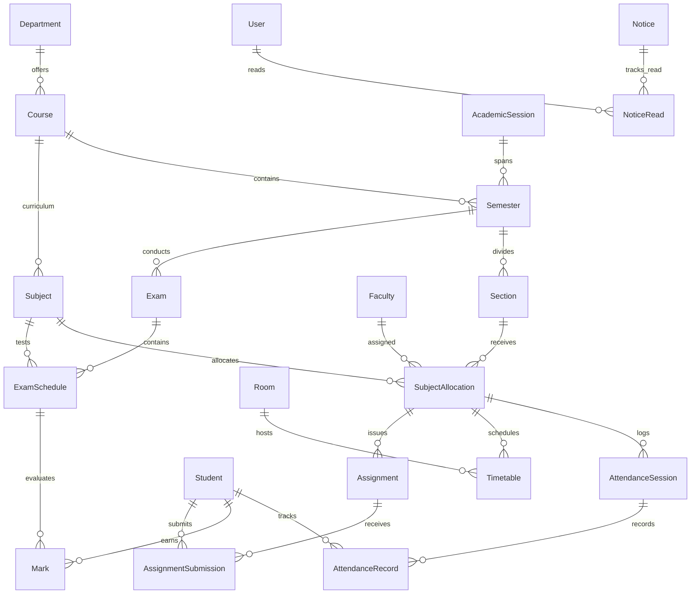

# College ERP System — Architecture & Technical Specifications

## 1. System Overview

The College ERP System is a full-stack, enterprise-grade educational management platform designed with a clean separation of concerns across presentation, business logic, data persistence, and security layers.

```
+-----------------------------------------------------------------------------------+
|                           REACT.JS SINGLE PAGE APP (VITE)                         |
|  Tailwind CSS  *  React Router DOM  *  Axios Interceptors  *  Recharts Visuals    |
+------------------------------------------+----------------------------------------+
                                           | HTTPS / REST (JSON)
                                           v
+-----------------------------------------------------------------------------------+
|                                FASTAPI BACKEND APP                                |
|  JWT Auth & RBAC  *  Pydantic Validation  *  Conflict Engine  *  Grading Engine   |
+------------------------------------------+----------------------------------------+
                                           | SQLAlchemy 2.0 ORM
                                           v
+-----------------------------------------------------------------------------------+
|                        RELATIONAL DATABASE (POSTGRESQL / SQLITE)                  |
|  Academic Hierarchy  *  Allocations  *  Attendance  *  Timetable  *  Exams/Marks  |
+-----------------------------------------------------------------------------------+
```

---

## 2. Relational Hierarchy & Data Integrity

The institutional hierarchy is maintained via foreign key constraints with indexed lookup keys:



---

## 3. Security Architecture & RBAC

1. **Authentication**:
   - `POST /api/v1/auth/login`: Issues standard short-lived JWT Access Token and Refresh Token with `sub`, `role`, `username`, and `email` claims.
   - Passwords hashed using `bcrypt` (12 rounds) with salt.
2. **Role-Based Authorization (`require_roles`)**:
   - `ADMIN`: Unrestricted administrative scope.
   - `FACULTY`: Scoped strictly to assigned subject allocations and departments.
   - `STUDENT`: Read-only access to published circulars, personal attendance, personal timetable, own coursework submissions, and officially published exam cards.
3. **Data Isolation & Object-Level Checks**:
   - Students cannot view or modify other students' marks or submissions.
   - Faculty cannot enter marks or take attendance for classes not allocated to them.
   - Unpublished exams and draft assignments are masked at the SQL query level.
4. **Input Sanitization & Validation**:
   - Pydantic v2 schemas enforce strict data types, date orderings, score ranges `[0, max]`, and time-slot consistency.
